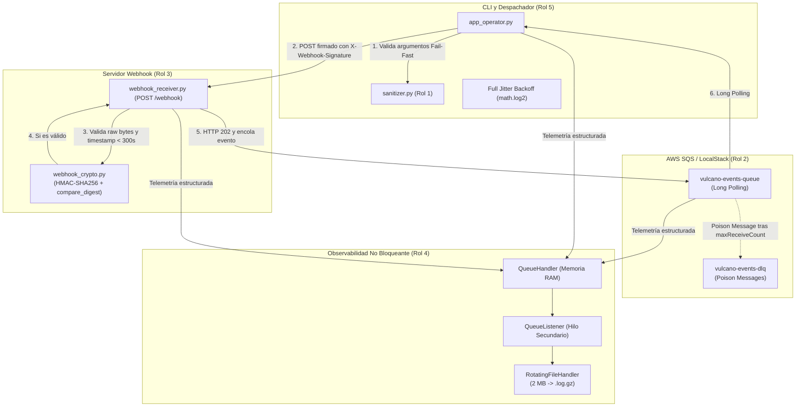

# Vulcano Pay — Motor de Eventos SQS, Webhooks HMAC y Observabilidad Asíncrona (TP-2)

Sistema de procesamiento de eventos financieros distribuido y desacoplado mediante **AWS SQS (LocalStack)** y **Boto3**, recepción y despacho de **Webhooks HTTP autenticados con HMAC-SHA256**, y pipeline de **observabilidad estructurada JSON no bloqueante** con compresión Gzip bajo **Python 3.14 (PEP 765)**.

---

## Integrantes y Asignación de Roles

| Rol | Integrante | Módulos a Cargo | Estado |
| :--- | :--- | :--- | :--- |
| **Rol 1:** Robustez de Entradas, Excepciones y Sanitización | **Paz Villarreal, Sebastián** | `src/vulcano_telemetry/exceptions.py`<br>`src/vulcano_telemetry/sanitizer.py` | Implementado |
| **Rol 2:** Mensajería Asíncrona SQS con Boto3 y LocalStack | **Vaca, Georgina Zulma** | `src/vulcano_telemetry/core_sqs.py` | Implementado |
| **Rol 3:** Seguridad Criptográfica HMAC y Receptor FastAPI | **Sosa, Tamara Gabriela** | `src/vulcano_telemetry/webhook_crypto.py`<br>`src/vulcano_telemetry/webhook_receiver.py` | Implementado |
| **Rol 4:** Observabilidad, Logging JSON y Compresión Gzip | **Isella, Lucía Daniza** | `src/vulcano_telemetry/logging_engine.py` | Implementado |
| **Rol 5:** Coordinador CLI, Despachador Webhook y `except*` | **Ahumada, Germán Maximiliano Leonel** | `src/app_operator.py`<br>`src/vulcano_telemetry/__init__.py` | Implementado |
| **Rol 6:** Simulación de Caos y Auditoría Forense de Logs | **Isasmendi, Leonel** | `tests/test_chaos.py`<br>`tests/test_forensic_log.py` | Implementado |

---

## Video de Presentación y Defensa Técnica

El video con la defensa de cada integrante del equipo, la explicación de arquitectura y la justificación de las decisiones de diseño se encuentra disponible en:

* **Video de la Defensa Técnica:** [https://youtu.be/QP6OSXfH79s](https://youtu.be/QP6OSXfH79s)

---

## Arquitectura del Sistema



---

## Estructura del Repositorio

```text
ProjVulcanoPay/
├── src/
│   ├── vulcano_telemetry/
│   │   ├── __init__.py           # Fachada pública (__all__) [Rol 5]
│   │   ├── exceptions.py         # Jerarquía semántica de errores [Rol 1]
│   │   ├── sanitizer.py          # Validadores declarativos argparse [Rol 1]
│   │   ├── core_sqs.py           # Cliente Boto3 SQS, Producer/Consumer [Rol 2]
│   │   ├── webhook_crypto.py     # Criptografía HMAC-SHA256 Timing-Safe [Rol 3]
│   │   ├── webhook_receiver.py   # Receptor HTTP FastAPI (POST /webhook) [Rol 3]
│   │   └── logging_engine.py     # QueueHandler/Listener y compresión Gzip [Rol 4]
│   └── app_operator.py           # Orquestador CLI con except* y PEP 765 [Rol 5]
├── tests/
│   ├── test_exceptions.py        # Tests de jerarquía de excepciones y add_note() [Rol 1]
│   ├── test_sanitizer.py         # Tests de validación CLI [Rol 1]
│   ├── test_chaos.py             # Inyección de caos, firmas inválidas y DLQ [Rol 6]
│   └── test_forensic_log.py      # Validación forense de logs y descompresión Gzip [Rol 6]
├── docs/
│   └── ROL1.md                   # Contrato de integración del Rol 1
├── requirements.txt              # Dependencias oficiales del proyecto
├── pyproject.toml                # Configuración de pruebas para pytest
└── README.md                     # Documentación técnica general
```

---

## Guía de Ejecución Local

### 1. Preparación del Entorno Virtual (Python 3.14)

```powershell
python -m venv .venv
.\.venv\Scripts\Activate.ps1
pip install -r requirements.txt
pip install flake8 pylint
```

### 2. Levantar LocalStack y Crear Colas SQS

Si utilizás Docker:
```bash
docker run -d --name localstack -p 4566:4566 localstack/localstack
```

Crear la Dead Letter Queue y la cola principal con su RedrivePolicy:
```bash
# Crear Dead Letter Queue (DLQ)
aws --endpoint-url=http://localhost:4566 sqs create-queue --queue-name vulcano-events-dlq

# Crear Cola Principal vinculada a la DLQ
aws --endpoint-url=http://localhost:4566 sqs create-queue --queue-name vulcano-events-queue \
  --attributes '{"RedrivePolicy": "{\"deadLetterTargetArn\":\"arn:aws:sqs:us-east-1:000000000000:vulcano-events-dlq\",\"maxReceiveCount\":\"3\"}"}'
```

### 3. Modos Operativos de la CLI (app_operator.py)

* **Iniciar el Servidor Receptor de Webhooks (FastAPI):**
  ```powershell
  python src/app_operator.py --mode start-receiver --url http://127.0.0.1:8000/webhook
  ```

* **Enviar un Webhook Firmado de Prueba:**
  ```powershell
  python src/app_operator.py --mode send-webhook --url http://127.0.0.1:8000/webhook
  ```

* **Publicar un Evento directamente en SQS:**
  ```powershell
  python src/app_operator.py --mode produce-sqs --queue vulcano-events-queue
  ```

* **Iniciar el Despachador de Eventos desde SQS (Long Polling):**
  ```powershell
  python src/app_operator.py --mode start-dispatcher --queue vulcano-events-queue --wait-time 10
  ```

---

## Ejecución de Pruebas y Calidad de Código

* **Correr la suite completa de pruebas:**
  ```powershell
  pytest -v
  ```

* **Auditoría de estilo y sintaxis (PEP 8):**
  ```powershell
  flake8 src/ tests/
  ```

* **Análisis estático de código:**
  ```powershell
  $env:PYTHONPATH="src"; pylint src/vulcano_telemetry/ src/app_operator.py
  ```

---

## Cumplimiento de las 6 Reglas Innegociables de la Cátedra

1. **Prohibición estricta de `BaseException`:** Todas las excepciones del paquete heredan de `VulcanoError(Exception)`. Ningún módulo captura `BaseException`.
2. **Norma PEP 765 (Python 3.14):** Ningún bloque `finally` contiene sentencias `return`, `break` ni `continue`.
3. **Boto3 con LocalStack:** Operaciones SQS ejecutadas mediante `boto3` apuntando al endpoint configurable `http://localhost:4566`.
4. **Validación sobre Raw Bytes:** El receptor FastAPI extrae `await request.body()` antes de deserializar JSON y valida HMAC-SHA256 con `hmac.compare_digest()`.
5. **Observabilidad Desacoplada (No Bloqueante):** Todo log en disco es procesado exclusivamente por `QueueHandler` y `QueueListener`.
6. **Timestamps en ISO 8601 UTC:** Fechas y marcas temporales serializadas con `datetime.now(timezone.utc).isoformat()`.